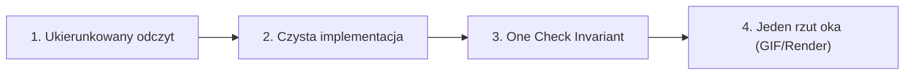

# Roadwork Fast Dev: Protokół 80/20 (Zero-Waste Development)

Protokół projektowy dla gry *Roadwork* (Londyn 1868, silnik izometryczny canvas/ESM). Zapewnia maksymalną jakość wizualną i stabilność kodu przy minimalnym nakładzie czasu, tokenów i ceremonii procesowych.

---

## 1. Złota zasada Pareto (20% pracy dla 80% efektu)

W grze retro 2D na canvasie wartość tworzą **dopracowane maszyny stanów, płynne animacje i klimat wizualny**. Nadmiarowe procedury zarządcze, kaskady recenzentów i wielotysięczne testy obciążeniowe są czystym marnotrawstwem.

### Hierarchia wykonania:
1. **Domyślnie tryb Solo Senior Dev**: Pojedynczy agent z narzędziami edycji kodu i shella realizuje zadanie w 3–5 minut. Nie deleguj lokalnych scen do roju agentów (`/teamwork`).
2. **Gdy użyty jest `/teamwork`**: Jeśli użytkownik wpisze `/teamwork`, bezwzględnie przekaż flagę `[skip-interview]`, o ile brief zawiera podstawowy opis pożądanych zachowań. Zakaz przeprowadzania ankiet z 6 pytaniami wielokrotnego wyboru.
3. **Zakaz roju eksploratorów**: Nie uruchamiaj 3 subagentów badawczych do zbadania 2 plików. Zastosuj celowany `grep` lub bezpośredni odczyt funkcji (`read_file`).

---

## 2. Pętla deweloperska w 4 krokach



### Krok 1: Ukierunkowany odczyt (Targeted Context)
- Ogranicz kontekst do plików bezpośrednio odpowiedzialnych za mechanikę:
  - Maszyny stanów i kinematyka: `src/port-life.js` lub `src/rooms.js`
  - Renderowanie grafiki na canvasie: `src/port-scenes.js` lub `src/*-scene.js`
  - Kotwiczenie w świecie i blokady ruchu: `src/port-district.js` lub `src/port-extension.js`
- Sprawdź długość cyklu ($T$ ticków) i istniejące punkty nawigacji (`SPOT`).

### Krok 2: Czysta implementacja (Robocza dyscyplina)
- **Determinizm modulo**: Każdy cykl rutyny opiera się na $t \pmod T$. Unikaj stanów ulotnych, które dryfują przy nieskończonej sesji (np. inwentarz ryb $2 \to 3 \to 2$).
- **Odporność na błędy numeryczne od razu w kodzie**:
  - Dzielenie i `Math.atan2`: Zawsze zabezpieczaj `dx || dy ? Math.atan2(dy, dx) : defaultHeading`.
  - Parabola skoku / rzutu: $4 \cdot h \cdot p \cdot (1 - p)$ z clampem $p \in [0, 1]$.
- **Natywne API canvasu**: Cieniowane pryzmaty izometryczne, proste cząsteczki i linie dają 10x lepszy efekt niż płaskie kreski bez grubości.

### Krok 3: The One Check Invariant (Minimalna skuteczna weryfikacja)
Zamiast rozbudowanych harnessów testowych obowiązują DWA szybkie sprawdzenia:
1. **Jeden mały plik testowy (`tests/<mechanika>.test.js`)**:
   - Maksymalnie 4–7 kluczowych asercji w natywnym `node:test`.
   - Sprawdź wyłącznie: przejścia stanów w kluczowych tickach, zamknięty bilans zasobów i brak NaN w pozycjach.
   - Zakaz pisania fuzzerów na $10^6$ ticków i skryptów `adversarial_*`.
2. **Weryfikacja typów**:
   - `npm run check` (`tsc --noEmit`) musi zwrócić kod 0.

### Krok 4: Weryfikacja wizualna (Jeden rzut oka)
- Wygeneruj **dokładnie jeden** artefakt weryfikacyjny:
  - Krótki render klatki lub GIF pełnego cyklu (np. Playwright do `artifacts/<nazwa>.gif`).
- Sprawdź go wzrokowo:
  - Czy postacie nie przenikają przez przeszkody?
  - Czy tempo ruchu i animacji pasuje do klimatu 1868 roku?
  - Czy nie ma lewitujących obiektów bez podkładów/cieni?
- Brak konieczności zwoływania 5 subagentów recenzujących. Jeśli obraz jest czysty, zadanie jest zakończone.

---

## 3. Katalog anty-wzorców (Czego NIE robić)

| Anty-wzorzec | Dlaczego szkodzi | Prawidłowe zachowanie |
|---|---|---|
| **Pytania o oczywistości w wywiadzie** | Męczy użytkownika i marnuje 10 minut na potwierdzanie tego, co napisał w briefie. | Zacznij od razu z flagą `[skip-interview]`. Wątpliwości rozwiązuj najbardziej naturalnym domysłem. |
| **Drabinki skryptów w `scratch/`** | Tworzenie `test1.mjs`, `check2.mjs`, `adversarial_stress.mjs`. | Dokładnie 1 docelowy plik testowy w `tests/` lub test bezpośrednio w `node --test`. |
| **Fuzzing i stress-testy dekoracji** | Badanie 6 640 klatek w poszukiwaniu dryfu 0.001 px w grze canvasowej. | 3 asercje na kluczowe ticki cyklu ($t=start$, $t=akcja$, $t=koniec$). |
| **Farma recenzentów (Gate Swarm)** | Uruchamianie Reviewer 1, Reviewer 2, Challenger 1, Challenger 2 do prostego PR-a. | Pojedyncza samoocena diffa (`git diff`) i weryfikacja testów jednostkowych. |

---

## 4. Przykładowa ściągawka CLI

```bash
# 1. Szybki test jednostkowy mechaniki
node --test tests/port-fisherman.test.js

# 2. Sprawdzenie zgodności typów
npm run check

# 3. Zrzut klatek pokoju lub sceny (jeśli istnieje skrypt renderujący)
node scripts/render-room.mjs --room=yard --times=600 --out=tmp_check

# 4. Sprawdzenie stanu repozytorium (dokładnie raz na koniec)
git status -s
```
